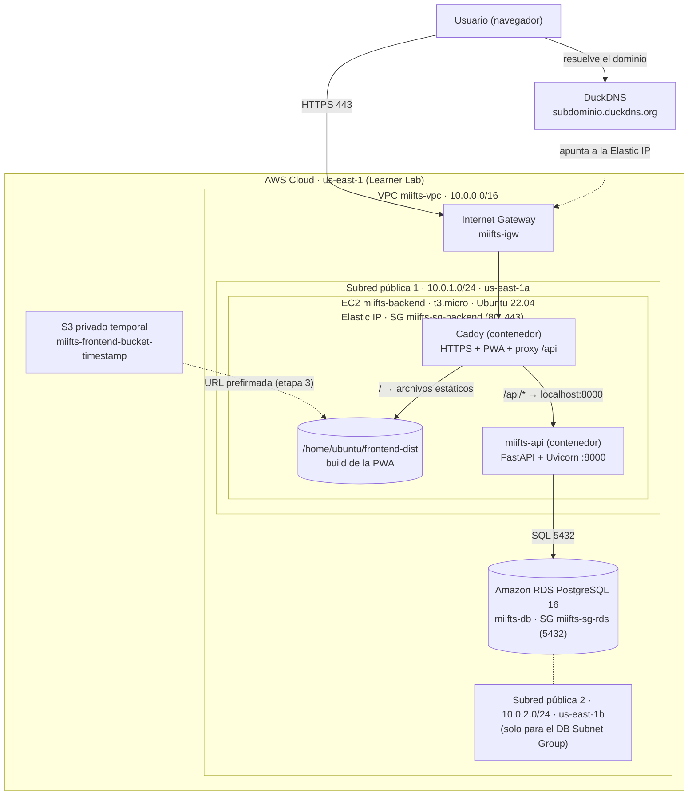
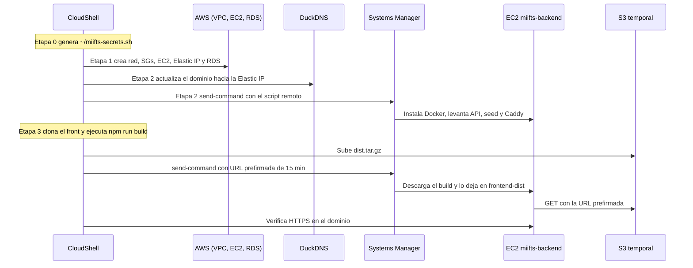

# Documentación de Despliegue - miIFTS en AWS

Despliegue automatizado de miIFTS (backend FastAPI + frontend PWA React) en **AWS Academy Learner Lab**, región `us-east-1`, desde **AWS CloudShell**. La aplicación queda publicada en `https://<subdominio>.duckdns.org` con certificado HTTPS automático.

**Contenido**

1. [Cómo hacer el despliegue](#1-cómo-hacer-el-despliegue)
2. [Arquitectura y decisiones técnicas](#2-arquitectura-y-decisiones-técnicas)
3. [Limitaciones conocidas y advertencias](#3-limitaciones-conocidas-y-advertencias)
4. [Troubleshooting](#4-troubleshooting)

---

## 1. Cómo hacer el despliegue

### 1.1 Requisitos

- Un **Learner Lab** de AWS Academy iniciado (esperar a que la luz se ponga verde).
- Acceso a **CloudShell** desde la consola de AWS (ya incluye `node`, `npm`, `git`, `openssl`, `python3` y `curl`).
- El rol **`LabInstanceProfile`**, que el Learner Lab ya provee (lo usa la EC2 para recibir comandos por Systems Manager).
- Una cuenta de **DuckDNS** con un subdominio creado y su **token**.
- Una cuenta de **Brevo** con credenciales SMTP (*SMTP y API → SMTP*), para el mail de recuperación de contraseña.

### 1.2 Pasos

1. Abrir CloudShell y traer los scripts (rama `dev`):

   ```bash
   git clone -b dev https://github.com/aka-leonel/mi_ifts_deployment.git
   cd mi_ifts_deployment
   ```

   (Alternativa: subir los archivos con *Actions → Upload file*.)

2. Dar permiso de ejecución:

   ```bash
   chmod +x etapa_0_secrets.sh etapa_1_infraestructura_cloud.sh \
            etapa_2_backend.sh etapa_3_frontend.sh etapa_4_cleanup.sh
   ```

3. Ejecutar las etapas **en orden y de a una**, esperando que cada una termine (la creación de RDS en la etapa 1 puede tardar varios minutos):

   ```bash
   ./etapa_0_secrets.sh               # solo la primera vez: pide SMTP (Brevo) y DuckDNS
   ./etapa_1_infraestructura_cloud.sh
   ./etapa_2_backend.sh
   ./etapa_3_frontend.sh
   ```

4. Al terminar, la etapa 3 imprime las direcciones:
   - PWA: `https://<subdominio>.duckdns.org`
   - API: `https://<subdominio>.duckdns.org/api/`

   La primera vez puede tardar un par de minutos hasta que Caddy emite el certificado.

5. **Liberar recursos al terminar** para no consumir créditos:

   ```bash
   ./etapa_4_cleanup.sh
   ```

> **Si falla cualquier etapa de la 1 a la 3:** ejecutar `./etapa_4_cleanup.sh` **dos veces** y empezar de nuevo desde la etapa 1. La etapa 0 no hace falta repetirla: los secretos se conservan en `~/miifts-secrets.sh`.

### 1.3 Resumen de las etapas

| Etapa | Script | Qué hace |
|-------|--------|----------|
| 0 | `etapa_0_secrets.sh` | Genera `~/miifts-secrets.sh` (permisos `600`). Genera solos `SECRET_KEY`, claves VAPID y `DB_PASSWORD`; pide por consola SMTP (Brevo) y DuckDNS. |
| 1 | `etapa_1_infraestructura_cloud.sh` | Crea VPC, subredes, IGW, route table, Security Groups, EC2 + Elastic IP y RDS PostgreSQL. |
| 2 | `etapa_2_backend.sh` | Actualiza DuckDNS y, por SSM, instala Docker en la EC2, despliega la API, corre el seed y levanta Caddy. |
| 3 | `etapa_3_frontend.sh` | Compila la PWA en CloudShell, la sube a un bucket S3 temporal y la publica en la EC2. |
| 4 | `etapa_4_cleanup.sh` | Elimina todos los recursos `miifts-*`. |
| - | `check_orphans.sh` | Auxiliar de solo lectura: lista recursos que pudieron quedar huérfanos. |

### 1.4 ¿Qué etapa repetir cuando cambia algo?

| Cambio | Qué hacer |
|--------|-----------|
| Nueva versión del frontend | Solo `./etapa_3_frontend.sh` |
| Cambio de credenciales SMTP o `SECRET_KEY` | `./etapa_0_secrets.sh` → `./etapa_2_backend.sh` |
| Cambio de claves VAPID | `./etapa_0_secrets.sh` → etapas 2 y 3 (la clave pública se compila dentro del front) |
| Cambio de subdominio/token de DuckDNS | `./etapa_0_secrets.sh` → etapas 2 y 3 |
| Cambio de `DB_PASSWORD` | No cambiarla con una base ya creada: el backend perdería la conexión. Solo aplica a despliegues nuevos (etapa 4 antes de la 1). |

### 1.5 Archivos de estado en el home de CloudShell

| Archivo | Lo genera | Contiene | Lo borra la etapa 4 |
|---------|-----------|----------|---------------------|
| `~/miifts-secrets.sh` | Etapa 0 | `SECRET_KEY`, VAPID, `DB_PASSWORD`, SMTP, DuckDNS | No |
| `~/miifts-ids.sh` | Etapa 1 (la 2 agrega `DOMAIN`, la 3 `BUCKET_NAME`) | IDs de recursos, `PUBLIC_IP`, `DB_HOST`, `DOMAIN`, `BUCKET_NAME` | Sí |

No se crean ni editan a mano, y **nunca** se suben a un repositorio. Si `~/miifts-ids.sh` existe antes de la etapa 1, esta se niega a ejecutarse (hay un despliegue sin limpiar).

---

## 2. Arquitectura y decisiones técnicas

### 2.1 Vista general



Componentes:

- **EC2** (`miifts-backend`): corre dos contenedores Docker con `--network host`: `miifts-api` (FastAPI) y `caddy`.
- **Caddy**: único punto de entrada. Emite y renueva el certificado de Let's Encrypt, sirve la PWA desde `/home/ubuntu/frontend-dist` (con fallback a `index.html`) y reenvía `/api/*` a `localhost:8000` **sin el prefijo `/api`**.
- **RDS PostgreSQL 16** (`miifts-db`, `db.t3.micro`, 20 GB, base `miifts`): base de datos desacoplada de la EC2.
- **Elastic IP** (`miifts-eip`): IP fija asociada a la EC2, a la que apunta el subdominio de DuckDNS.
- **S3**: bucket privado temporal, usado solo para transportar el build del frontend a la EC2.

### 2.2 Flujo de una petición

1. El navegador entra a `https://<subdominio>.duckdns.org`.
2. DuckDNS resuelve a la Elastic IP.
3. Caddy (puertos 80/443 de la EC2) responde con la PWA o, si la ruta empieza con `/api/`, reenvía a la API (puerto 8000, **bloqueado por el Security Group**, solo accesible desde la propia EC2).
4. La API consulta RDS (puerto 5432, accesible únicamente desde el Security Group de la EC2).

### 2.3 Red y Security Groups

| Security Group | Entrada permitida | Origen |
|----------------|-------------------|--------|
| `miifts-sg-backend` (EC2) | TCP 80 | `0.0.0.0/0` (necesario para el desafío de Let's Encrypt) |
| `miifts-sg-backend` (EC2) | TCP 443 | `0.0.0.0/0` |
| `miifts-sg-rds` (RDS) | TCP 5432 | Solo desde el SG `miifts-sg-backend` |

El puerto 8000 de la API **no** se abre: se accede a través de Caddy en `https://<dominio>/api`.

### 2.4 Despliegue paso a paso (cómo interactúan los servicios)



Detalle técnico de cada etapa:

- **Etapa 1.** Valida que no exista `~/miifts-ids.sh` y que exista `~/miifts-secrets.sh`. Va guardando cada ID en `~/miifts-ids.sh` apenas lo crea. Tiene un `trap` de error que avisa que se ejecute la etapa 4 si algo falló. Usa la AMI más reciente de Ubuntu 22.04 (owner `099720109477`).
- **Etapa 2.** Actualiza DuckDNS (debe responder `OK`), guarda `DOMAIN` en `~/miifts-ids.sh`, espera hasta 40 intentos (10 s c/u) a que la instancia esté `Online` en SSM y envía un script remoto con timeout de 1800 s. El script remoto instala Docker, clona/actualiza la rama `dev` de `backend-ifts`, genera el `.env` (permisos `600`), construye la imagen, levanta `miifts-api`, espera a que responda (hasta 5 min; las migraciones corren al iniciar), ejecuta `seed.py` y levanta Caddy con un `Caddyfile` para el dominio.
- **Etapa 3.** Instala `git-lfs` si hace falta (`dnf` o binario oficial de GitHub), clona/actualiza la rama `dev` de `frontend-miifts`, descarga las imágenes de LFS y **aborta si quedan punteros LFS** en los `.png`. Escribe el `.env` del front con `VITE_API_URL=https://<dominio>/api` y la clave pública VAPID, compila con Vite, sube el build a S3, lo publica en la EC2 por SSM y verifica que `https://<dominio>/` responda 200 (hasta 12 intentos).
- **Etapa 4.** Busca los recursos por tag/nombre, sin depender de `~/miifts-ids.sh`. Ver [2.7](#27-diseño-de-la-limpieza-etapa-4).

### 2.5 Decisiones de diseño

| Decisión | Detalle |
|----------|---------|
| **Base de datos en RDS, no en un contenedor de la EC2** | Está desacoplada de la EC2: si la instancia se reinicia o se actualiza, los datos no se pierden. |
| **Dos subredes públicas en zonas de disponibilidad distintas** (`us-east-1a` y `us-east-1b`) | Requisito de RDS para crear el DB Subnet Group. La EC2 va solo en la subred 1. |
| **RDS sin acceso público y con SG propio** | `--no-publicly-accessible`; el puerto 5432 solo acepta tráfico desde el SG de la EC2. Se crea sin Multi-AZ (`--no-multi-az`). |
| **Elastic IP en la EC2** | Da una IP fija para el subdominio de DuckDNS. Cobra si queda sin asociar, por eso la etapa 4 la libera. |
| **Dominio DuckDNS + Caddy** | Caddy emite y renueva solo el certificado de Let's Encrypt, sirve la PWA y hace de proxy de la API: un único punto de entrada (80/443). El certificado se guarda en el volumen Docker `caddy_data`. |
| **API no expuesta + CORS limitado** | El puerto 8000 no se abre en el SG y `CORS_ORIGINS` contiene solo el dominio (`https://<dominio>`). |
| **Frontend y API bajo el mismo dominio** | La PWA consume la API en `https://<dominio>/api`; Caddy quita el prefijo `/api` antes de reenviar. |
| **Comandos a la EC2 por SSM** | La EC2 se lanza con `LabInstanceProfile` y recibe los scripts por Systems Manager (`AWS-RunShellScript`); no se configura SSH ni key pair. |
| **Build del front en CloudShell y transporte por S3 privado + URL prefirmada** | CloudShell ya trae `node`/`npm`. El build se comprime, se sube a un bucket privado temporal y la EC2 lo descarga con una URL prefirmada de 15 minutos. Luego se borra el archivo del bucket y el bucket se elimina en la etapa 4. |
| **Secretos fuera del repositorio** | `etapa_0_secrets.sh` no contiene secretos (se puede versionar): genera los valores en CloudShell y los guarda en `~/miifts-secrets.sh` con permisos `600`. |
| **`DB_PASSWORD` se genera una sola vez** | Cambiarla con una base ya creada dejaría al backend sin conexión. |
| **Clave pública VAPID compilada en el front** | Si se regeneran las claves VAPID hay que repetir las etapas 2 y 3. Las notificaciones push requieren HTTPS (según la documentación técnica del backend). |
| **Control de Git LFS antes de publicar** | Las imágenes del front están en Git LFS; sin `git-lfs` el clone baja punteros de texto y la app quedaría sin logo ni íconos. La etapa 3 corta antes de publicar. |
| **Contenedores con `--restart unless-stopped`** | `miifts-api` y `caddy` se reinician solos si la EC2 se reinicia. |
| **Archivos temporales con secretos se borran siempre** | Las etapas 2 y 3 usan `trap ... EXIT` para eliminar `/tmp/remote_deploy.sh`, `/tmp/ssm_params.json`, etc. |
| **`~/miifts-ids.sh` como guarda anti-duplicados** | Si existe, la etapa 1 no corre: evita crear un segundo despliegue encima de uno sin limpiar. |

### 2.6 Adaptaciones al Learner Lab

| Condición del Learner Lab | Cómo se resuelve |
|---------------------------|------------------|
| Región `us-east-1` | Todos los scripts fijan `AWS_DEFAULT_REGION=us-east-1`. `check_orphans.sh` asume esa única región (acepta otra como argumento). |
| El Lab provee el rol `LabInstanceProfile` | Se asigna a la EC2 para poder usar SSM, sin crear roles propios. |
| Se trabaja desde CloudShell | Los scripts se ejecutan ahí; el build del front también se compila ahí. Por eso `~/miifts-secrets.sh` y `~/miifts-ids.sh` viven en el home de CloudShell. |
| Amazon SES devolvió acceso denegado (`ses:GetAccount`) en el Lab | El envío del mail de recuperación de contraseña se hace por **SMTP de Brevo** (`smtp-relay.brevo.com:587`, STARTTLS). |
| Los créditos del Lab se consumen mientras haya recursos activos | La etapa 4 elimina todo, incluidas las Elastic IP (cobran si quedan sin asociar). |
| Existe una VPC default en la región | La etapa 4 solo toca recursos `miifts-*` y nunca la VPC default. |

### 2.7 Diseño de la limpieza (etapa 4)

La etapa 4 busca los recursos **por tag/nombre o identificador**, sin depender estrictamente de `~/miifts-ids.sh`, por lo que también limpia restos de ejecuciones anteriores que hayan fallado a mitad. Orden de eliminación y motivo:

1. **RDS `miifts-db`** (`--skip-final-snapshot --delete-automated-backups`), esperando a que termine de borrarse.
2. **DB Subnet Group**, antes que la red para liberar las subredes. Reintenta hasta 20 veces (10 s) hasta que AWS lo libera.
3. **Buckets S3** `miifts-frontend-bucket-*` (con todo su contenido).
4. **Instancias EC2** con tag `miifts-backend`, esperando a que terminen.
5. **DuckDNS**: vacía el registro (`clear=true`) para que no apunte a una IP liberada. Es de mejor esfuerzo: si falla, no frena la limpieza.
6. **Elastic IPs** con tag `miifts-eip`.
7. **VPC `miifts-vpc`**: Security Groups (hasta 6 reintentos), subredes, route tables, Internet Gateway y la VPC.
8. Borra `~/miifts-ids.sh` (no borra `~/miifts-secrets.sh`).

El script **no verifica ni devuelve error** si algún recurso no se pudo eliminar; por eso se recomienda ejecutarlo dos veces y revisar con `check_orphans.sh`, que solo **lista** (no borra): instancias EC2, Elastic IPs, volúmenes EBS sin adjuntar, VPCs (marca la default), Internet Gateways, NAT Gateways, Security Groups no default, instancias/subnet groups/snapshots manuales de RDS, Load Balancers y buckets S3.

### 2.8 Recursos AWS creados

| Recurso | Nombre / tag | Función | Lo crea |
|---------|--------------|---------|---------|
| VPC | `miifts-vpc` (`10.0.0.0/16`) | Red del despliegue (DNS support y hostnames habilitados) | Etapa 1 |
| Internet Gateway | `miifts-igw` | Salida/entrada a Internet de la VPC | Etapa 1 |
| Subred pública 1 | `miifts-public-1` (`10.0.1.0/24`, `us-east-1a`) | Aloja la EC2 | Etapa 1 |
| Subred pública 2 | `miifts-public-2` (`10.0.2.0/24`, `us-east-1b`) | Necesaria para el DB Subnet Group de RDS | Etapa 1 |
| Route table | `miifts-rt-public` | Ruta `0.0.0.0/0` → IGW, asociada a ambas subredes | Etapa 1 |
| Security Group EC2 | `miifts-sg-backend` | Permite 80 y 443 desde cualquier origen | Etapa 1 |
| Security Group RDS | `miifts-sg-rds` | Permite 5432 solo desde `miifts-sg-backend` | Etapa 1 |
| Instancia EC2 | `miifts-backend` (`t3.micro`, Ubuntu 22.04, `LabInstanceProfile`) | Corre la API y Caddy en Docker | Etapa 1 |
| Elastic IP | `miifts-eip` | IP fija de la EC2 para DuckDNS | Etapa 1 |
| DB Subnet Group | `miifts-db-subnet-group` | Subredes donde puede ubicarse RDS | Etapa 1 |
| Instancia RDS | `miifts-db` (PostgreSQL 16, `db.t3.micro`, 20 GB, base `miifts`) | Base de datos de la aplicación | Etapa 1 |
| Bucket S3 | `miifts-frontend-bucket-<timestamp>` (privado) | Transporte temporal del build del front | Etapa 3 |
| Registro DuckDNS | `<subdominio>.duckdns.org` (externo a AWS) | Dominio que apunta a la Elastic IP | Etapa 2 (lo vacía la etapa 4) |
| Contenedor `miifts-api` | - | API FastAPI (puerto 8000) | Etapa 2 |
| Contenedor `caddy` | volumen `caddy_data` | HTTPS, PWA y proxy `/api/*` | Etapa 2 |

Todos los recursos de AWS llevan tag `Name` con prefijo `miifts`; la etapa 4 los elimina a todos (excepto los contenedores, que desaparecen junto con la EC2).

---

## 3. Limitaciones conocidas y advertencias

- **No es un despliegue de producción.** Es un entorno de aprendizaje.
- **Los secretos viajan a la EC2 dentro del comando de SSM**, por lo que quedan en el historial de Systems Manager de la cuenta.
- **Re-ejecutar la etapa 2 vuelve a correr `seed.py`**, que según la documentación técnica del backend hace `drop_all` + `create_all` y recarga los datos iniciales: se pierden los datos cargados en RDS. Tenerlo en cuenta antes de repetirla en un despliegue con datos que importen.
- **Límite de Let's Encrypt:** cada despliegue desde cero pide un certificado nuevo para el mismo dominio y hay un límite semanal de certificados idénticos (alrededor de 5). Si se repiten muchos despliegues seguidos, el certificado puede demorar o fallar hasta que se libere el límite.
- **Una sola EC2 y RDS sin Multi-AZ:** no hay alta disponibilidad.
- **La limpieza no verifica sus resultados:** ejecutar `etapa_4_cleanup.sh` dos veces y confirmar con `check_orphans.sh`.
- **Cambiar `SECRET_KEY` cierra las sesiones activas**, y regenerar las claves VAPID invalida las suscripciones push existentes.
- **El borrado de DuckDNS en la etapa 4 es de mejor esfuerzo.**

---

## 4. Troubleshooting

### 4.1 Regla general

Si falla cualquier etapa de la 1 a la 3: `./etapa_4_cleanup.sh` **dos veces** y volver a empezar desde la etapa 1. Si quedan dudas, correr `./check_orphans.sh`.

### 4.2 Por etapa

| Etapa | Síntoma | Qué hacer |
|-------|---------|-----------|
| 0 | `Falta 'openssl'` o `'python3'` | Ejecutar en CloudShell (ya los trae). |
| 0 | Subdominio inválido | Solo letras, números y guiones; sin `.duckdns.org`. |
| 1 | `Ya existe ~/miifts-ids.sh` | Hay un despliegue sin limpiar: ejecutar `./etapa_4_cleanup.sh`. |
| 1 | `Falta ~/miifts-secrets.sh` o `DB_PASSWORD` | Ejecutar `./etapa_0_secrets.sh`. |
| 1 | `La etapa 1 falló...` | Ejecutar la etapa 4 (dos veces) y repetir desde la 1. |
| 2 | `DuckDNS respondió: ...` distinto de `OK` | Revisar subdominio y token: `./etapa_0_secrets.sh` (opción de cambiar DuckDNS) y repetir la etapa 2. |
| 2 | `La instancia no apareció en SSM` | Verificar que el Lab esté activo (luz verde) y que la EC2 se haya lanzado con `LabInstanceProfile`; esperar y repetir la etapa 2. |
| 2 | `La API no respondió en 5 minutos` | El script imprime los últimos logs de `miifts-api`; revisarlos (migraciones, `DATABASE_URL`). |
| 2 | `El despliegue del backend falló (<estado>)` | El script imprime las últimas 60 líneas de salida de SSM. |
| 3 | `npm no está instalado` | Ejecutar desde CloudShell. |
| 3 | `Las imágenes ... no se descargaron de Git LFS` | Revisar la instalación de `git-lfs` y repetir la etapa 3. No se publica una app rota. |
| 3 | `Falló la publicación del front (<estado>)` | Revisar la salida impresa; la URL prefirmada dura 15 min, repetir la etapa 3 (se puede ejecutar sola). |
| 3 | `https://<dominio>/` no responde 200 | Ver 4.3. |
| 4 | Quedan recursos (VPC, IGW, SG, subnet group) | Ejecutar la etapa 4 una segunda vez y confirmar con `check_orphans.sh`. |

### 4.3 El certificado tarda o el DNS no propagó

La etapa 3 espera hasta 12 intentos (10 s) y, si no obtiene 200, avisa que el front quedó publicado pero el dominio aún no responde. Causas posibles según los scripts: DNS sin propagar o Caddy terminando de emitir el certificado. Pasos:

```bash
source ~/miifts-ids.sh
nslookup "$DOMAIN"            # debe devolver la IP de $PUBLIC_IP
curl -I "https://$DOMAIN/"     # esperar 200
```

- Si el DNS no apunta a `$PUBLIC_IP`, repetir la etapa 2 (vuelve a actualizar DuckDNS) o revisar subdominio y token.
- Si el DNS es correcto, esperar unos minutos y repetir el `curl`.
- Para ver los logs de Caddy en la EC2 (no se usa SSH, se hace por SSM):

  ```bash
  CMD=$(aws ssm send-command --instance-ids "$INSTANCE_ID" \
    --document-name AWS-RunShellScript \
    --parameters 'commands=["docker logs --tail 50 caddy 2>&1"]' \
    --query Command.CommandId --output text)
  sleep 5
  aws ssm get-command-invocation --command-id "$CMD" --instance-id "$INSTANCE_ID" \
    --query StandardOutputContent --output text
  ```

- Recordar el límite semanal de certificados de Let's Encrypt si se hicieron muchos despliegues seguidos (ver sección 3).

### 4.4 El mail de recuperación llega con link a `localhost`

El link se arma con `FRONTEND_RESET_PASSWORD_URL`, que la etapa 2 define como `https://<subdominio>.duckdns.org/reset-password`. Sin esa variable el backend usa `http://localhost:5173/reset-password`. Si cambió el dominio: `./etapa_0_secrets.sh` y repetir las etapas 2 y 3. Si falta `SMTP_HOST`, el backend no envía nada (solo registra un warning, sin el token).
